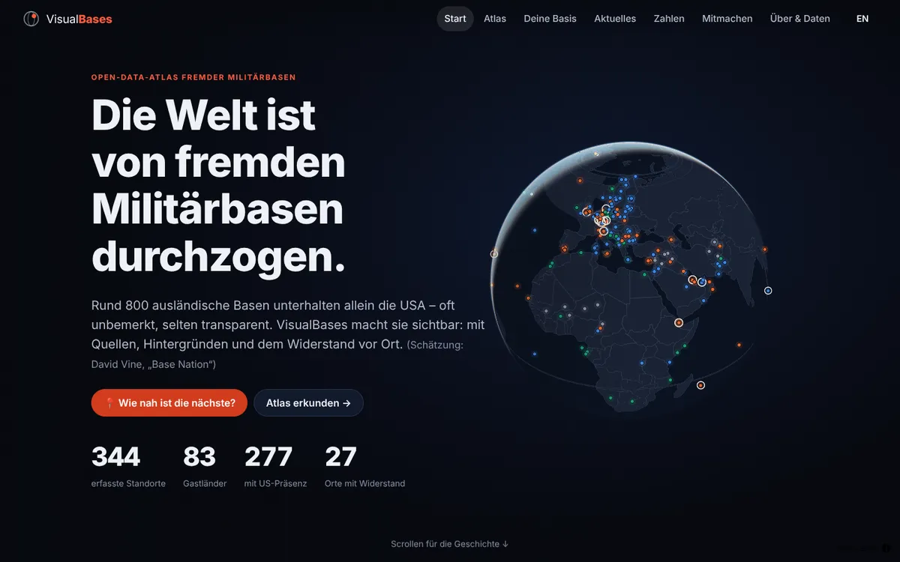
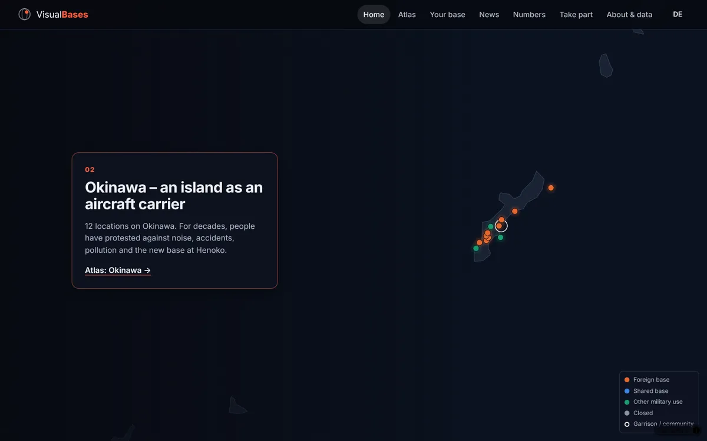
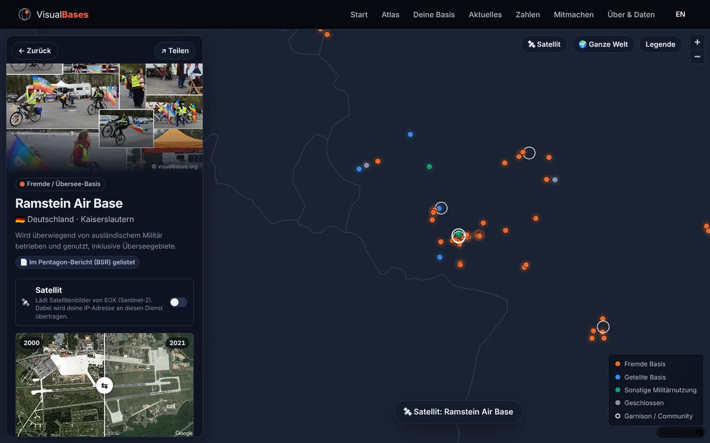
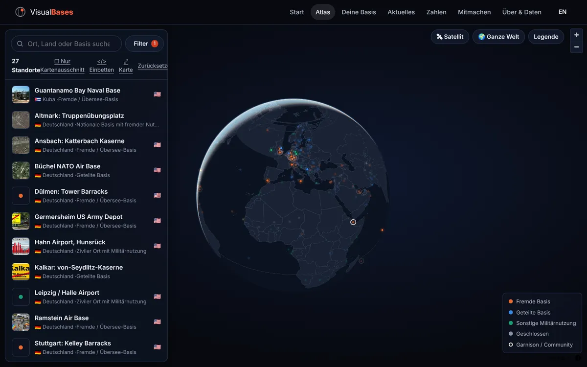
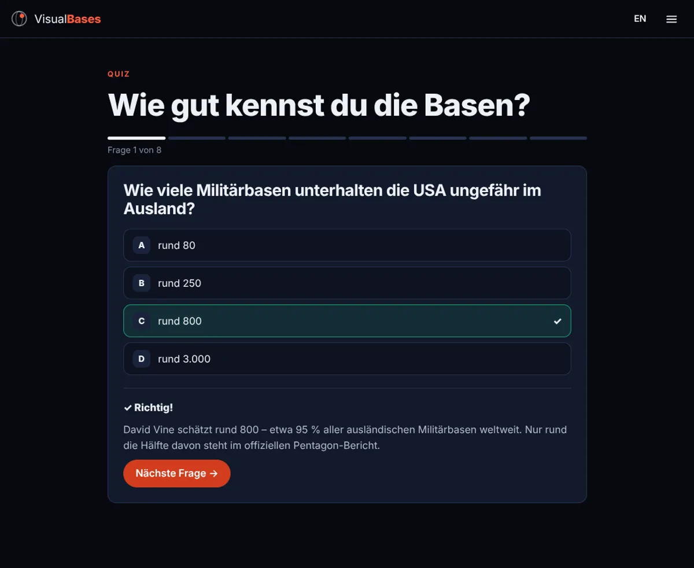

# VisualBases

**Ein interaktiver Open-Data-Atlas ausländischer Militärbasen weltweit, gebaut als moderne, schnelle Web-App ohne Tracking.**

🌍 **Live:** https://acephali92.github.io/VisualBases/



VisualBases macht sichtbar, was selten sichtbar ist: **365 Standorte in über 80 Ländern**, eingeordnet nach Art, Stationierungsnation, Einrichtungen und Themen (Drohnenkrieg, Atomwaffen, Umweltschäden, Widerstand vor Ort). Dazu gibt es Satelliten-Vergleiche, echte Fotos, Quellen und eine laufende Presseschau.

> Idee, Recherche und Datenbestand stammen von **[visualbases.org](https://visualbases.org)** (Karl-Heinz Peil, Friedens- und Zukunftswerkstatt e. V., in Zusammenarbeit mit World BEYOND War). Dieses Repository ist eine eigenständige Neuentwicklung als offene Web-App, mit Zustimmung des Initiators.

| Story auf dem Globus | Standort-Profil mit Vorher/Nachher |
|---|---|
|  |  |
| **Atlas mit Filtern** | **Quiz** |
|  |  |

## Funktionen

| | |
|---|---|
| 🌍 **Globus-Story** | 3D-Globus, der beim Scrollen eine Geschichte erzählt: Netz → Deutschland → Okinawa → Afrika → Widerstand |
| 🔎 **Atlas** | Filter (Art, Nation, Einrichtung, Thema, Kontinent), Suche, Liste mit Vorschaubildern, „nur Kartenausschnitt“, teilbare Links |
| 🛰 **Standort-Profile** | Titelfoto, **Vorher/Nachher-Regler** mit historischen Satellitenbildern, Galerie, Quellen, Nachrichten, Orte in der Nähe, „Fehler melden“ |
| 📷 **Authentische Bilder** | 134 Bilder aus dem visualbases.org-Archiv (Satelliten-Zeitreihen, Karten, Protestfotos) und frei lizenzierte Fotos von Wikimedia Commons, jeweils mit Urheber und Lizenz |
| 📍 **Deine Basis** | Entfernung zur nächsten Basis (wird im Browser berechnet) und ein **Story-Bild 1080×1920** zum Teilen |
| 📰 **Aktuelles** | Kuratierte Presseschau (DE/EN), Meldungen sind automatisch mit den Basen verknüpft |
| ✊ **Mitmachen** | Orte mit Widerstand und ihre Kampagnen, internationale Netzwerke, Kongress 2021 mit Rednerinnen und Rednern, Hinweis-Formular |
| 🛰 **Zeitreisen aus dem All** | 15 Basen mit historischen Satellitenbildern als Vorher/Nachher-Regler, z. B. Ramstein 2000→2021, Agadez 2017→2021 |
| 🗺 **Länderansicht** | Filter nach Gastland mit Übersicht (Standorte, Stationierungsstaaten, Arten, Bilder) |
| 🖼 **Teilbare Bilder** | Story-Bild „Deine Basis“ (1080×1920) und Karte für jede Basis (1080×1350) mit echtem Foto |
| 📅 **Basis des Tages** | Täglich wechselnde Basis mit Bild auf der Startseite |
| ❓ **Quiz** | 8 Fragen, Zahlen live aus dem Datensatz, Ergebnis zum Teilen |
| 🎓 **Für Schulen** | 5 druckbare Unterrichtsbausteine (ab Klasse 9) nach dem Beutelsbacher Konsens |
| 📊 **Zahlen** | Statistiken mit Tabellenansicht |
| `</>` **Einbetten** | Karte (auch gefiltert) per iframe auf Partnerseiten zeigen |
| ⬇ **Offene Daten** | `data/bases.csv`, `bases.geojson`, `bases.json` |
| 🔗 **Teilen & Suche** | Statische Seiten pro Basis (365) und pro Land (83) mit Vorschaubild (Open Graph), Sitemap, strukturierte Daten |
| ✉ **Hinweise** | Über GitHub-Formulare oder per E-Mail, ohne Konto |
| 🌐 **DE / EN** · 📱 **PWA** · ♿ **Barrierearm** · 🔒 **Kein Tracking** | |

## Datenschutz

Keine Cookies, keine Analyse-Tools, keine Google-Dienste. Weltkarte (Natural Earth) und Schrift (Inter) sind Teil der App. Externe Anfragen gibt es nur, wenn man sie selbst auslöst: Satellitenbilder (EOX Sentinel-2) und Ortssuche (OpenStreetMap Nominatim).

## Technik

- [Svelte 5](https://svelte.dev) + TypeScript + [Vite](https://vite.dev), statisches Hosting (GitHub Pages)
- [MapLibre GL JS](https://maplibre.org) mit Globus-Projektion
- `vite-plugin-pwa` (Workbox), `sharp` für die Bildoptimierung
- Tests: Vitest (Unit), Chromium-Smoke-Test aller Seiten (Desktop und Handy), `svelte-check`, axe-core-Prüfung

```
data/                     Quelldaten (im Repo versioniert)
  bases.json              365 Standorte
  media.json              optimierte Bilder (Typ, Jahr, Urheber, Lizenz)
  wikimedia.json          frei lizenzierte Fotos von Commons (Urheber, Lizenz)
  news.json               Presseschau
  movement.json           Initiativen und Kongress
public/media/             Bilder als WebP (1400 px und Vorschaubilder)
scripts/
  import-visualbases.mjs  Standorte und Bild-Referenzen von visualbases.org
  import-news.mjs         Presseschau (EN/DE)
  import-wikimedia.mjs    freie Fotos von Wikimedia Commons (nur freie Lizenzen, nur thematisch passend)
  build-media.mjs         Bilder laden, einordnen, als WebP optimieren (--prune räumt auf)
  build-data.mjs          public/data/*.json|geojson|csv
  prerender.mjs           statische Seiten pro Basis, sitemap.xml, robots.txt
src/
  lib/                    Daten, Filter, i18n, Router, Karte, Quiz, Share-Bild
  routes/                 Home, Atlas, Near, Space, News, Stats, Act, Quiz, School, About, Embed
  components/             BaseProfile, Gallery, Compare, NewsList, BarChart, Legend
tests/smoke.cjs           Browser-Test aller Seiten
```

## Entwicklung

```bash
npm install
npm run dev          # http://localhost:5173
npm test             # Unit-Tests
npm run check        # Typprüfung
npm run validate     # Datenprüfung (läuft auch vor jedem Build)
npm run data:report  # Datenqualitätsbericht nach docs/data-quality-report.md
npm run build        # Produktions-Build nach dist/
npm run test:smoke   # Browser-Test (nach dem Build)
```

Daten aktualisieren (die Crawler sind bewusst langsam und nutzen einen Cache in `.cache/`):

```bash
npm run data:import      # Standorte
npm run data:news        # Presseschau
NODE_USE_ENV_PROXY=1 node scripts/import-wikimedia.mjs   # nur nötig hinter einem Proxy
npm run data:media       # Bilder laden und optimieren
```

## Datenqualität

Jeder Build und jedes Daten-Update wird mit `npm run validate` geprüft (Koordinaten, Duplikate, Länder, Kategorien, Bildreferenzen, Lizenzen). Fehler verhindern das Deployment. Zweifelhafte Positionen stehen in `data/corrections.json` und werden in der App als „Position ungeprüft“ gekennzeichnet. Details: [docs/DATA-QUALITY.md](docs/DATA-QUALITY.md) · aktueller [Bericht](docs/data-quality-report.md) · [Roadmap](docs/IMPROVEMENT-ROADMAP.md) · [Changelog](docs/CHANGELOG.md).

## Quellenrecherche

Zu den 291 Standorten ohne eigene Quelle gibt es einen Recherche-Datensatz in `data/research/` (Quellen mit Herausgeber, Datum, Abrufdatum und Prüfurteil; BSR-, Wikidata- und OSM-Prüfungen). Er wird erst nach Durchsicht in die App übernommen. Methode, Kennzahlen und Befunde: [docs/research/SOURCE-RESEARCH.md](docs/research/SOURCE-RESEARCH.md) · alle Datenquellen und Dienste: [docs/DATA-SOURCES.md](docs/DATA-SOURCES.md).

```bash
node scripts/research/inspect.mjs <url> [stichwort …]   # Quelle abrufen und prüfen
node scripts/research/manual.mjs                        # data/research/manual.json übernehmen
node scripts/research/bsr.mjs                           # Base-Structure-Report-Abgleich (+ bsr-review.json)
node scripts/research/summarize.mjs                     # Bericht und coverage.csv neu erzeugen
```

## Automatische Aktualisierung

Der Workflow `.github/workflows/update-data.yml` läuft jeden Montag (und auf Knopfdruck unter *Actions*). Er lädt nur geänderte Beiträge von visualbases.org neu, aktualisiert die Presseschau und die freien Fotos und öffnet einen Pull Request mit den Änderungen.

## Deployment

Jeder Push auf `main` wird über `.github/workflows/deploy.yml` geprüft (Typen, Unit-Tests, Build, Browser-Test) und auf GitHub Pages veröffentlicht. In den Repository-Einstellungen muss dafür **Settings → Pages → Source: „GitHub Actions“** gewählt sein.

## Mitmachen

- **Hinweis oder Korrektur:** über die [Issue-Formulare](https://github.com/Acephali92/VisualBases/issues/new/choose). Bitte immer mit Quelle.
- **Code, Übersetzungen, Design:** Pull Requests sind willkommen.

## Lizenz und Quellen

- **Code:** MIT (siehe `LICENSE`).
- **Daten:** [CC BY 4.0](https://creativecommons.org/licenses/by/4.0/deed.de), Namensnennung „VisualBases – visualbases.org (Karl-Heinz Peil, Friedens- und Zukunftswerkstatt e. V.), CC BY 4.0“. Geltungsbereich und Ausnahmen: [`data/LICENSE.md`](data/LICENSE.md). Die Downloads enthalten die Lizenz als `LICENSE.txt`.
- **Eigene Bilder aus dem Archiv von visualbases.org:** Nutzung mit Zustimmung des Initiators; nicht von CC BY 4.0 erfasst.
- **Fotos von Wikimedia Commons:** jeweils unter der angegebenen freien Lizenz (Urheber und Link im Bild-Dialog sowie in `data/wikimedia.json`).
- **Google-Earth-Bilder:** © Google, nicht-kommerzielle Nutzung mit Namensnennung.
- **Kartengrundlage:** Natural Earth (gemeinfrei). **Satellitenbilder:** Sentinel-2 cloudless © EOX IT Services GmbH (enthält modifizierte Copernicus-Sentinel-Daten), CC BY-NC-SA 4.0.
